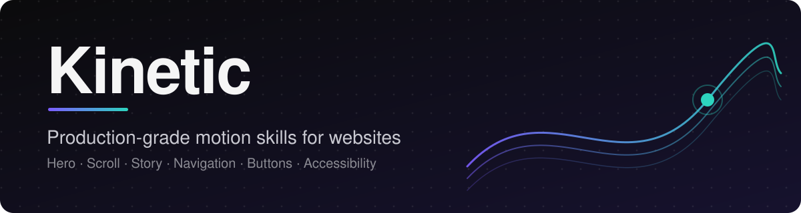
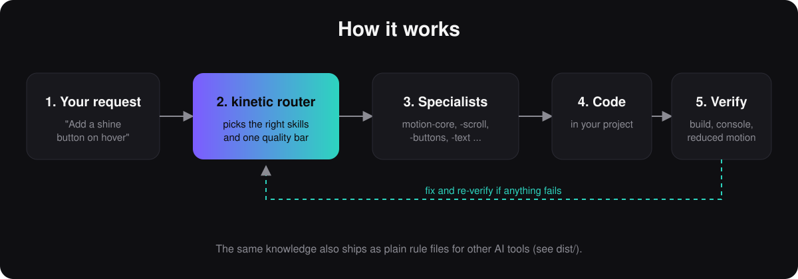
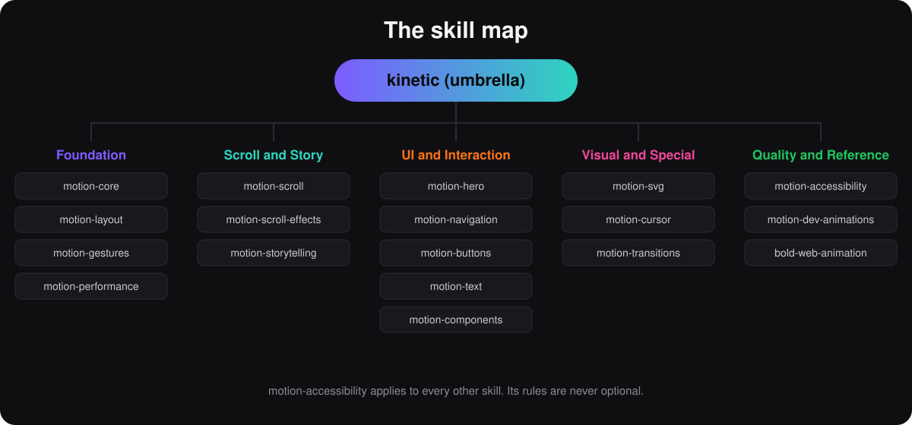
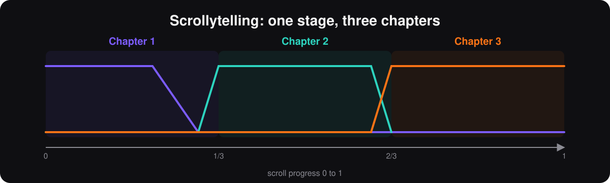
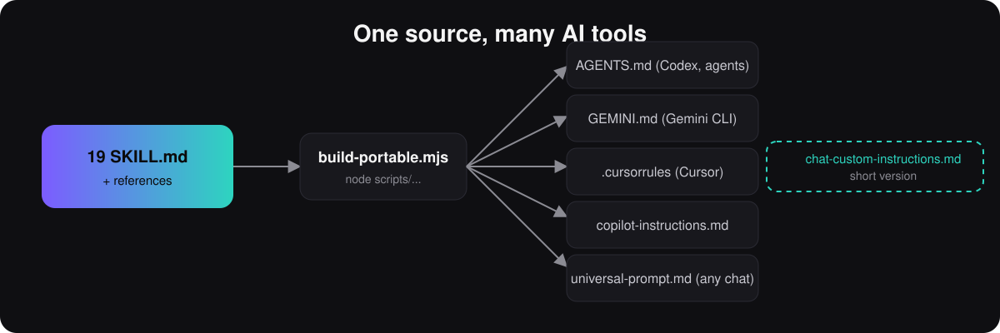

<div align="center">



[](LICENSE)
[](#skill-catalog)
[](#install-claude-code)
[](https://motion.dev)

**Kinetic** teaches AI assistants how to add polished, production-grade motion to websites:
hero intros, scroll effects, scrollytelling, navigation, buttons, modals, text, SVG, cursor effects,
plus performance and accessibility rules.

</div>

---

## Table of contents

- [What is Kinetic](#what-is-kinetic)
- [How it works](#how-it-works)
- [Quick start](#quick-start)
- [Skill catalog](#skill-catalog)
- [Install: Claude Code](#install-claude-code)
- [Usage](#usage)
- [Scrollytelling](#scrollytelling)
- [Use with other AI tools](#use-with-other-ai-tools)
- [Core rules](#core-rules)
- [Troubleshooting](#troubleshooting)
- [Verification status](#verification-status)
- [Repository layout](#repository-layout)
- [Contributing](#contributing)
- [License](#license)

---

## What is Kinetic

Kinetic is a set of **skills**: structured instructions that an AI assistant loads when it needs to
write animation code. You describe what you want in plain language. The assistant picks the right
skill, writes the code into your project, and checks it against the same rules every time.

The patterns are built on the **Motion** library (`motion/react` for React, `motion` for vanilla
JavaScript, see [motion.dev](https://motion.dev)). A **GSAP** skill is included for projects that
already use GSAP and ScrollTrigger.

Kinetic works in two ways:

| Setup | What you get |
|---|---|
| **Claude Code** | The `kinetic/` umbrella skill and the `motion-*/` skills load automatically |
| **Any other AI tool** | Ready-made rule files in `dist/` for Cursor, GitHub Copilot, Gemini CLI, Codex, or any chat app |

---

## How it works

<div align="center">

</div>

1. **You make a request**, for example "add a shine button on hover".
2. **The `kinetic` router** reads the request and chooses the matching specialist skills.
3. **Specialist skills** supply tested patterns, props, and pitfalls for that area.
4. **The assistant writes the code** into your project, using the library your project already uses.
5. **Verification** runs: build, console check, reduced motion, keyboard focus, and mobile width.

---

## Quick start

| If you want to... | Start with |
|---|---|
| Not sure which skill applies | [`kinetic/`](kinetic/SKILL.md) (the umbrella skill) |
| Add scroll effects (zoom, parallax, tilt, progress) | [`motion-scroll-effects/`](motion-scroll-effects/SKILL.md) |
| Build a story-style scroll section | [`motion-storytelling/`](motion-storytelling/SKILL.md) |
| Animate a hero section | [`motion-hero/`](motion-hero/SKILL.md) |
| Build a header or navigation | [`motion-navigation/`](motion-navigation/SKILL.md) |
| Polish buttons and calls to action | [`motion-buttons/`](motion-buttons/SKILL.md) |
| Copy a motion.dev example | [`motion-dev-animations/`](motion-dev-animations/SKILL.md) |
| Work on a GSAP project | [`bold-web-animation/`](bold-web-animation/SKILL.md) |

---

## Skill catalog

<div align="center">

</div>

### Umbrella

| Skill | Purpose |
|---|---|
| [`kinetic`](kinetic/SKILL.md) | Routes a request to the right skill, applies one quality bar, and runs a final checklist |

### Foundation

| Skill | Purpose |
|---|---|
| [`motion-core`](motion-core/SKILL.md) | Variants, springs, keyframes, stagger, `useAnimate`, reduced motion |
| [`motion-layout`](motion-layout/SKILL.md) | Shared elements (`layoutId`), expand and collapse, tab underline, reorder, `AnimatePresence` modes |
| [`motion-gestures`](motion-gestures/SKILL.md) | Hover, tap, focus, drag, swipe, pan, pinch |
| [`motion-performance`](motion-performance/SKILL.md) | `LazyMotion`, bundle size, debugging janky animations, large lists |

### Scroll and story

| Skill | Purpose |
|---|---|
| [`motion-scroll`](motion-scroll/SKILL.md) | `useScroll`, `useTransform`, `whileInView`, `inView`, and the `scroll()` API |
| [`motion-scroll-effects`](motion-scroll-effects/SKILL.md) | Ten ready effects: progress bar, zoom hero, word highlight, clip reveal, horizontal scroll, parallax, 3D tilt, color shift, stagger grid, scroll-linked number |
| [`motion-storytelling`](motion-storytelling/SKILL.md) | Chapter-based sticky stories and step timelines |

### UI and interaction

| Skill | Purpose |
|---|---|
| [`motion-hero`](motion-hero/SKILL.md) | Staged intros, masked reveals, media reveal, marquee |
| [`motion-navigation`](motion-navigation/SKILL.md) | Hide-on-scroll header, active section indicator, mobile drawer, menus |
| [`motion-buttons`](motion-buttons/SKILL.md) | Shine sweep, press feedback, loading to success, icon swap |
| [`motion-text`](motion-text/SKILL.md) | Split text, typewriter, scramble, scroll word highlight, counters |
| [`motion-components`](motion-components/SKILL.md) | Accordion, tabs, dropdown, toast stack, skeleton, carousel, card stack, floating action button, command palette |

### Visual and special

| Skill | Purpose |
|---|---|
| [`motion-svg`](motion-svg/SKILL.md) | Path draw, path morph, animated icons, loaders |
| [`motion-cursor`](motion-cursor/SKILL.md) | Custom spring cursor, magnetic elements, cursor trail |
| [`motion-transitions`](motion-transitions/SKILL.md) | Route transitions, curtain wipe, modal, drawer, toast |

### Quality and reference

| Skill | Purpose |
|---|---|
| [`motion-accessibility`](motion-accessibility/SKILL.md) | Reduced motion, seizure safety, focus, screen readers. Applies to every other skill |
| [`motion-dev-animations`](motion-dev-animations/SKILL.md) | Hub and catalog of motion.dev examples |
| [`bold-web-animation`](bold-web-animation/SKILL.md) | GSAP and ScrollTrigger: hero, reveals, parallax, pinned scroll |

---

## Install: Claude Code

Claude Code loads skills from `~/.claude/skills/` (available in every project) or from
`<project>/.claude/skills/` (available in one project only). Copy each skill folder there.

**Windows (PowerShell)**

```powershell
$src = "C:\path\to\Kinetic"
$dst = "$env:USERPROFILE\.claude\skills"
New-Item -ItemType Directory -Force -Path $dst | Out-Null
Get-ChildItem $src -Directory | Where-Object { Test-Path (Join-Path $_.FullName "SKILL.md") } | ForEach-Object {
  Copy-Item -Recurse -Force $_.FullName (Join-Path $dst $_.Name)
}
```

**macOS and Linux**

```bash
src=/path/to/Kinetic
dst=~/.claude/skills
mkdir -p "$dst"
for d in "$src"/*/; do
  [ -f "$d/SKILL.md" ] && cp -r "$d" "$dst/"
done
```

To clone the repository first:

```bash
git clone https://github.com/arg0506/Kinetic.git
```

> After copying, start a **new** Claude Code session. Skills are triggered automatically by their
> `description` field.

---

## Usage

Make a direct request. The clearer it is, the better the result.

```text
Use kinetic to give this hero section a premium intro. The stack is React + Vite.
```

```text
Build a story-style scroll section: three chapters, a sticky visual on the left, text on the right.
```

```text
Hide the header on scroll down and bring it back on scroll up.
```

```text
This button should sweep a shine on hover, and on click show "Sending", then "Sent".
```

```text
Add parallax and a 3D tilt with motion-scroll-effects, and disable them on mobile.
```

```text
This is a GSAP project. Use bold-web-animation for the hero and reveals.
```

### Writing a good request

| Include | Example |
|---|---|
| **Where** | "the landing page hero", "the pricing section" |
| **Feel** | subtle, bold, or cinematic |
| **Stack** | React, Vue, vanilla JavaScript, or GSAP |
| **Constraints** | mobile support, performance budget, accessibility level |

---

## Scrollytelling

Scrollytelling pins one visual to the screen and changes the content as the reader scrolls.
Kinetic's story pattern uses a tall scroll range and a sticky stage. Each chapter fades in and out
over its own part of the progress range.

<div align="center">

</div>

Key points from [`motion-storytelling`](motion-storytelling/SKILL.md):

- The scroll range is `chapters x 100vh`, and the stage is `position: sticky`.
- Keep every scroll offset inside `[0, 1]`. Values outside that range trigger a browser error that can
  crash the React tree.
- Use real state updates only when the active chapter changes, not on every frame.

---

## Use with other AI tools

Claude Code skills do not run in other tools. The build script converts every skill into plain
Markdown rule files.

<div align="center">

</div>

The generated files are in `dist/`:

| File | Where to use it |
|---|---|
| `dist/AGENTS.md` | Generic agent standard, read by many coding agents. Place at the project root |
| `dist/GEMINI.md` | Gemini CLI. Place at the project root |
| `dist/.cursorrules` | Cursor (legacy rules file). Place at the project root |
| `dist/.github/copilot-instructions.md` | GitHub Copilot. Place under the project's `.github/` folder |
| `dist/universal-prompt.md` | Paste into any chat AI as the first message |
| `dist/chat-custom-instructions.md` | Short version for "custom instructions" boxes in chat apps |

Notes:

- The full files are about 130 KB. Some tools limit rule-file size. If a tool truncates the file, use
  `chat-custom-instructions.md` or paste one skill at a time.
- Each tool behaves differently. The bundles are generated, but they have not been tested in every tool.

To regenerate the bundles after editing a skill:

```bash
node scripts/build-portable.mjs
```

---

## Core rules

Every skill follows these rules:

1. Animate only `transform` and `opacity`. Use `layout` or `layoutId` for size and position changes.
2. Respect reduced motion. Wrap the app root in `<MotionConfig reducedMotion="user">`.
3. Keep scroll-linked `useTransform` input ranges inside `[0, 1]`.
4. Give `AnimatePresence` children stable keys. Do not use array indexes for reorderable lists.
5. Keep motion values out of React state.
6. Clean up `animate()`, `scroll()`, `inView()`, and event listeners on unmount.
7. Split text needs real space characters between words and an `aria-label` on the parent.
8. Use the animation library the project already has (`motion`, `framer-motion`, or `gsap`). Do not add a second one.
9. Keep intros under two seconds. Entrances take 0.6 to 1.0 s, hover effects 0.2 to 0.4 s, and the default easing is `[0.22, 1, 0.36, 1]`.

---

## Troubleshooting

| Problem | Likely cause | Fix |
|---|---|---|
| Blank page, console shows `Offsets must be...` | A scroll range falls outside `[0, 1]` | Clamp the range (see [`motion-scroll`](motion-scroll/SKILL.md)) |
| Exit animation does not play | `AnimatePresence` is inside the condition, or a child has no `key` | Move `AnimatePresence` outside the condition and give each child a stable key |
| Animation stutters | Tailwind `transition-*` classes conflict with Motion | Remove `transition-*` from motion elements |
| Next.js: "motion is not defined" | The file is not a client component | Add `"use client"` at the top of the file |
| Words run together in split text | No real space between words | Render `{" "}` between words; a CSS margin is not enough |
| Navigation shows above a modal | Nav `z-index` is higher than the overlay | Give the overlay a higher `z-index` than the nav |
| Scroll effect never reaches 100% | The effect ends at the bottom of the page | Add a `100vh` spacer after the section |
| Layout jumps while scrolling | Width or height is tweened inside a layout animation | Use the `layout` prop instead |

---

## Verification status

What has been checked, and what has not:

| Area | Status |
|---|---|
| Motion API snippets (TypeScript) | Type-checked against the latest `motion` (14.x) |
| Story, navigation, buttons, modal, scroll effects, gestures | Checked in a browser on an internal test page: opacity, transform, clip-path, background, and text values. No console errors |
| Animation feel (timing, easing, smoothness) | Not checked by the authors. Review it in a browser |
| motion.dev examples | Source verified for a few of the 520+ demos. The rest are approximations, and the skill files say so |
| Paywalled demos (Copy Button, Typewriter) | Exact source was not available. The code is an approximation |
| `motion-svg`, `motion-cursor`, `bold-web-animation` | Code review only. Not browser-tested |
| Multi-AI rule files | Generated and checked for content. Not tested in each tool |
| Full production site | Not tested end to end. Check on your own project before shipping |

---

## Repository layout

```text
Kinetic/
├── README.md                    this file
├── LICENSE                      MIT
├── assets/                      SVG illustrations used in this README
├── kinetic/                     umbrella skill (start here)
├── motion-*/                    specialist skills (each has SKILL.md and optional references/)
├── bold-web-animation/          GSAP skill
├── scripts/
│   └── build-portable.mjs       builds the rule files in dist/
└── dist/                        generated rule files for other AI tools
```

---

## Contributing

To add or change a skill:

1. Create a folder with a `SKILL.md` file. Its frontmatter needs `name` (matching the folder name)
   and `description` (what the skill does and when to use it).
2. Put long reference material in `references/*.md`.
3. Add the skill to the catalog in this README and to the specialist table in `kinetic/SKILL.md`.
4. Run `node scripts/build-portable.mjs` to regenerate `dist/`.
5. Open a pull request with a short description of what changed and how you checked it.

---

## License

Released under the MIT License. See [LICENSE](LICENSE).
